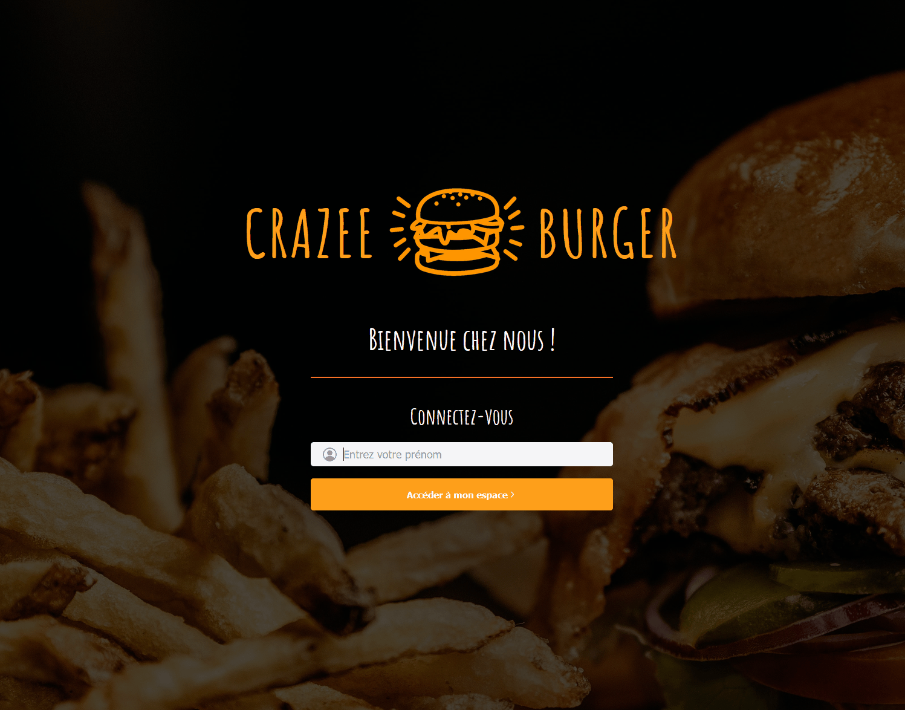

# 🍔 Crazee Burger — Application client

> Application de commande pour restaurant : le client choisit ses burgers, boissons et suppléments, et compose son panier. Le menu est géré depuis un back-office séparé, [crazee-burger3-admin](https://github.com/lletierce/crazee-burger3-admin).

🔗 **Démo en ligne : [crazee-burger](https://crazee-burger-seven.vercel.app/)**
🛠️ **Back-office : [crazee-burger-dev-adm.web.app](https://crazee-burger-dev-adm.web.app/)**



---

## 🔑 Tester l'application

Entre simplement ton **prénom** : aucun compte n'est nécessaire.

> 💡 Pour voir le lien entre les deux projets : connecte-toi au [back-office](https://crazee-burger-dev-adm.web.app/) avec le compte de démonstration indiqué dans son [README](https://github.com/lletierce/crazee-burger3-admin#-tester-lapplication), modifie le prix d'un produit ou mets-le en avant, puis recharge cette application : la modification apparaît.

---

## ✨ Fonctionnalités

- **Connexion par prénom** : chaque prénom a son propre panier
- **Menu** lu en direct depuis le catalogue du back-office
- **Badges** « Nouveau » (produits mis en avant) et visuel « Épuisé » (produits indisponibles)
- **Panier** latéral : ajout, suppression, quantités et total animé
- Un produit épuisé reste dans le panier mais n'est **pas compté** dans le total
- **Panier sauvegardé** dans le navigateur : il est retrouvé après un rechargement ou une reconnexion
- **Design responsive** : affichage dédié sur mobile, avec un panier escamotable

---

## 🔗 Lien avec le back-office

Les deux applications partagent **le même projet Firebase**. Le back-office est la seule source de vérité : il **écrit** les produits, et cette application ne fait que les **lire**.

```
crazee-burger3-admin ──écrit──▶  Firestore « products »  ◀──lit── crazee-burger
   (administrateurs)              (projet partagé)              (clients)
```

### Contrat de données

Les produits sont stockés par le back-office avec ses propres noms de champs. Ils sont convertis **une seule fois**, à la lecture, dans [`src/api/product.js`](./src/api/product.js) : le reste de l'application n'a pas eu à changer.

| Firestore (`products`) | Application client | Utilisation |
|---|---|---|
| identifiant du document | `id` | Lien entre le menu et le panier |
| `name` | `title` | Nom affiché |
| `imageUrl` (optionnel) | `imageSource` | Image, ou visuel « bientôt disponible » à défaut |
| `price` | `price` | Prix et total du panier |
| `isAvailable` | `isAvailable` | Visuel « Épuisé », exclusion du total |
| `isPromoted` | `isPublicised` | Badge « Nouveau » |

Les autres champs (`category`, `quantity`, `slug`, dates) sont propres au back-office et ne sont pas utilisés ici. Le modèle complet est défini dans [`product.types.ts`](https://github.com/lletierce/crazee-burger3-admin/blob/main/src/features/products/types/product.types.ts).

---

## 🛠️ Stack technique

| Domaine | Technologies |
|---|---|
| Front-end | React 18, JavaScript, Create React App |
| Style | Styled-components |
| Navigation | React Router 6 |
| Animations | React Transition Group |
| Données | Cloud Firestore (lecture seule) |
| Hébergement | Vercel |

---

## 🧩 Choix techniques

### Organisation du code

```
src/
├── api/            # Accès à Firestore et conversion des produits
├── components/
│   ├── pages/      # Pages : connexion, commande, erreur
│   └── reusable-ui/# Composants génériques : boutons, cartes, champs…
├── context/        # Contexte de la page de commande (menu, panier)
├── enums/          # Constantes : images par défaut, messages
├── hooks/          # Hooks personnalisés : useMenu, useBasket
├── theme/          # Couleurs, typographies, espacements, animations
└── utils/          # Fonctions utilitaires : prix, tableaux, localStorage
```

L'état de la page de commande est géré par deux **hooks personnalisés** (`useMenu`, `useBasket`) et partagé avec les composants par un **Context React**.

### Un panier léger et robuste

- Le panier ne stocke que des **identifiants et des quantités** (`[{ id, quantity }]`) : les informations du produit (nom, prix, image) sont toujours lues dans le menu, donc toujours à jour.
- Au chargement, les produits du panier qui **n'existent plus** dans le menu (supprimés depuis le back-office) sont retirés automatiquement.

### Gestion des erreurs

Si le menu ne peut pas être chargé, l'application affiche un message d'attente plutôt qu'un chargement infini, et le panier sauvegardé est conservé intact.

---

## 🔒 Sécurité

- **Pas de vraie authentification** : le prénom sert uniquement à personnaliser l'accueil et à retrouver le panier, stocké dans le navigateur. Aucune donnée personnelle n'est envoyée à un serveur.
- **Accès en lecture seule** : les [règles de sécurité Firestore](https://github.com/lletierce/crazee-burger3-admin/blob/main/firestore.rules), gérées dans le dépôt du back-office, autorisent tout le monde à lire les produits, mais réservent toute écriture aux administrateurs.
- La configuration Firebase présente dans le code n'est **pas un secret** : elle identifie le projet, mais ce sont les règles Firestore qui protègent les données.

---

## 📖 Origine du projet

Ce projet est né lors de la formation **Développeur React — Vi-Dev**. Dans cette première version, chaque utilisateur avait sa propre copie du menu, modifiable depuis un « mode admin » intégré.

🏷️ **Cette version est conservée telle quelle : [tag `v1-formation`](https://github.com/lletierce/crazee-burger/tree/v1-formation).**

Je l'ai ensuite fait évoluer seul avec Claude, pour la relier à mon back-office :

- **Suppression du mode admin**, remplacé par le back-office dédié
- **Lecture du catalogue commun** (collection `products`) à la place d'un menu par utilisateur
- **Connexion par prénom** sans écriture en base
- **Robustesse du panier** face aux produits supprimés, et gestion des erreurs de chargement
- **Nettoyage** : code mort, dépendances inutilisées, un seul gestionnaire de paquets (npm)

L'architecture d'origine a été volontairement conservée : l'objectif était d'adapter l'application à la nouvelle source de données, pas de la réécrire.

---

## 🚀 Installation en local

### Prérequis

- [Node.js](https://nodejs.org/) (version LTS)
- Un projet [Firebase](https://console.firebase.google.com/) avec une collection `products` lisible publiquement, par exemple celui du back-office

### Étapes

```bash
# 1. Cloner le dépôt
git clone https://github.com/lletierce/crazee-burger.git
cd crazee-burger

# 2. Installer les dépendances
npm install

# 3. Configurer les variables d'environnement
cp .env.example .env
# puis renseigner les valeurs du projet Firebase dans .env

# 4. Lancer le serveur de développement
npm start
```

### Variables d'environnement

```env
REACT_APP_API_KEY=
REACT_APP_AUTH_DOMAIN=
REACT_APP_PROJECT_ID=
REACT_APP_STORAGE_BUCKET=
REACT_APP_MESSAGING_SENDER_ID=
REACT_APP_APP_ID=
```

Les valeurs se trouvent dans la console Firebase : ⚙️ Paramètres du projet → Général → Vos applications → Configuration du SDK.

### Scripts disponibles

| Commande | Description |
|---|---|
| `npm start` | Lance le serveur de développement sur [localhost:3000](http://localhost:3000) |
| `npm run build` | Génère la version de production dans `build/` |

---

## ☁️ Déploiement

L'application est déployée sur **Vercel**, connecté au dépôt GitHub :

- chaque **pull request** obtient un déploiement de prévisualisation ;
- chaque **merge sur `main`** déclenche le déploiement en production.

Les variables d'environnement sont configurées dans les réglages du projet Vercel. Elles sont intégrées au moment du build : toute modification nécessite un nouveau déploiement.

---

## 🗺️ Évolutions possibles

- [ ] **Affichage par catégorie** (Burger, Boisson, Supplément), déjà disponibles dans le catalogue
- [ ] **Mise à jour en temps réel** du menu (`onSnapshot`), sans rechargement de la page
- [ ] **Harmonisation visuelle** avec le design system du back-office
- [ ] **Tests** des fonctions du panier

---

## 👤 Auteur

**Loris LETIERCE** — Développeur React junior, en recherche d'emploi

[LinkedIn](https://www.linkedin.com/in/loris-letierce-9863a1159) · [GitHub](https://github.com/lletierce) · [Email](mailto:letierce.lo@gmail.com)
